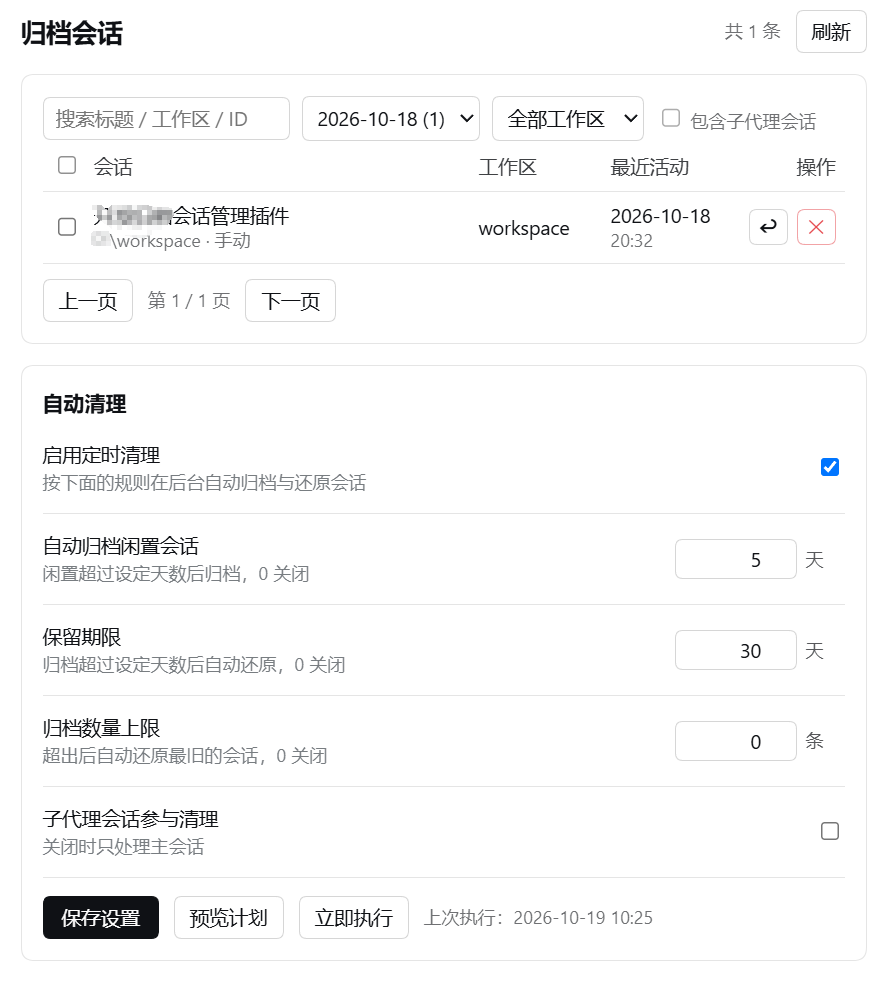

# Archive Manager for DSH · 归档会话管理

> 给 DeepSeek Harness 补上缺失的**归档管理中心**：侧栏「会话」只有"显示/隐藏已归档"一个开关，
> 归档之后既看不见、也找不回。装上本插件，**设置 → 归档会话**里就能按日期翻出历史会话、
> 一键批量取消归档，还有一套可撤销的自动清理策略替你收拾越来越长的会话列表。

[[English](#english)](#english)

[](https://dsh-plugin.org/plugins/gsnowdrift/dsh-archive-manager)

## 安装

```bash
dsh plugin --profile web add @gsnowdrift/dsh-archive-manager
```

桌面版把 profile 换成 `desktop`：

```bash
dsh plugin --profile desktop add @gsnowdrift/dsh-archive-manager
```

装完重启 DSH（或重新打开客户端），进入 **设置 → 归档会话**。

<details>
<summary>从源码安装 / 本地开发</summary>

```bash
git clone https://github.com/gsnowdrift/dsh-archive-manager.git
dsh plugin --profile desktop add "file:D:/path/to/dsh-archive-manager"
```

或在 Web 侧栏 **插件** 页 → 安装 → 输入本地绝对路径。
若 pnpm 拒绝 `file:`，可把 `link:` 依赖写进 profile 的 `package.json`，patch 见本仓库的 `cordis.patch.yml`。

</details>

## 能做什么

| 功能 | 说明 |
| --- | --- |
| 归档列表 | 标题、工作区、路径、归档时间、最近活动、来源（手动/自动）、运行状态 |
| 按日期筛选 | 归档日下拉（每天的数量）· 搜索标题/路径/会话 ID · 按工作区筛选 · 含子代理会话 |
| 分页 | 每页 25 条，页码与总数 |
| 批量操作 | 勾选后一键取消归档；单条"取消归档" |
| 删除会话 | 单条删除**磁盘上的会话记录**，需二次确认、不可恢复（仅在你主动点击时发生） |
| 自动清理 | 三种可组合、**可逆**的策略，支持"预览计划"和"立即执行" |
| 设置持久化 | 策略保存在插件自己的 storage domain（`archive_manager`），跨重启保留 |

### 截图



### 自动清理策略

| 策略 | 作用 | 默认 |
| --- | --- | --- |
| `cleanupEnabled` | 定时清理总开关（每 `cleanupIntervalMinutes` 分钟一次，默认 30） | 关 |
| `autoArchiveDays` | 闲置超过 N 天的普通会话**自动归档**（从侧栏隐藏） | 90 天，0 关闭 |
| `retentionDays` | 归档超过 N 天的会话**自动取消归档**（回到侧栏原位） | 180 天，0 关闭 |
| `capCount` | 归档数量超过 N 时，**自动取消归档最旧的** | 0 关闭 |
| `includeSubagents` | 子代理会话是否参与清理 | 关 |

> **自动清理不会物理删除任何会话日志。** DSH 的会话持久化层没有保留/清理接口，本插件的"清理"
> 只在**归档集合**与**侧栏可见性**之间移动会话，全部可逆；历史、工作区归属、保存的位置都不会丢。
> 唯一的删除入口是列表里你自己点的「删除」，且需要二次确认。

运行中的会话一律跳过（`excluded`），不会打断正在跑的工作。

## 使用

1. 打开 **设置**（侧栏齿轮），左栏点 **归档会话**；
2. 顶部下拉选择归档日，或用搜索 / 工作区筛选；标题未折叠完成时先显示会话 ID，几秒后自动替换；
3. 勾选若干行 → **取消归档 N 项**，它们会回到原工作区原来的位置；
4. 下方"自动清理"卡片里调整策略 → **保存设置** → **预览计划** 先看清楚，再 **立即执行**。

## 结构

```text
package.json          # dsh.bundle.patch + dsh.client 声明
cordis.patch.yml      # bundle patch：插入 archive-manager 行
lib/index.js          # Host 半：ArchiveManagerService（Remote 命名空间 archiveManager）
lib/client.js         # Client 半：设置页 section（原生 ESM，无构建步骤）
locale/{zh,en}.json   # 面板元信息
```

### Host Remote API（`remote.archiveManager`）

| 方法 | 参数 | 返回 |
| --- | --- | --- |
| `list` | `{ filter?: { date?, workspaceId?, search?, includeSubagents? }, page?, pageSize? }` | `{ total, page, pageCount, items[], workspaces, dates[], pending }` |
| `getSettings` | — | `{ policy, lastRun, intervalMinutes }` |
| `setPolicy` | policy 的部分字段 | 合并后的 policy |
| `unarchive` | sessionIds | `{ moved, failed[] }` |
| `deleteSessions` | sessionIds | `{ deleted, done[], failed[] }` |
| `preview` | — | 清理计划（不执行） |
| `runCleanup` | `{ dryRun? }` | 执行结果 `{ actions[], excluded[], applied, failed[] }` |

### 依赖

Host 半只使用 profile 已经提供的包：`@deepseek-ai/cordis`、`@deepseek-ai/schemastery`、
`@deepseek-ai/dsh-typert-protocol`、`@deepseek-ai/dsh-storage-domain`、`@deepseek-ai/dsh-session-query`、
`@deepseek-ai/dsh-workspace` 与 `zod`（都写在 `peerDependencies`，不额外安装）。

## 权限与数据

| 项 | 说明 |
| --- | --- |
| 读取什么 | profile 里已归档会话的元信息；折叠标题时读取这些会话自己的 JSONL 日志 |
| 写什么 | 归档集合（`workspaces` 的 `archivedSessionIds`）与插件自己的 storage 文件 `archive_manager.json` |
| 删除什么 | 只在用户点击"删除"并二次确认后，删除对应会话日志目录；自动清理**永不删除** |
| 网络 | 不发任何网络请求，不采集遥测，不连接外部服务 |
| 凭据 | 不读写任何密钥 |

## 已知限制

- 归档集合本身不记录归档时间：本插件在看到某会话进入归档集合的那一刻记录时间；
  插件首次启动前就已归档的会话，用该会话 header 的创建时间兜底。
- 标题从会话日志里的 `session/title` 折叠而来，无法在请求里实时完成（冷启 85 个会话约 6 秒），
  因此首次打开列表时新会话可能短暂显示 ID，后台折叠完成后自动替换。
- 极少数只有控制事件的会话（例如被拆分进来的子会话）本身没有标题事件，只能显示 ID。
- 只注册了 `settings.section` 一处入口；宿主改这个 slot 名时该分区会静默不出现。
- 面向 DSH 0.2.x 的 Web/桌面客户端；Host 侧未在纯 CLI profile 上验证。

## English

**Archive Manager for DSH** adds the archived-session management surface that DeepSeek Harness lacks:
browse archived sessions by date / workspace / title, unarchive them in bulk, and run a reversible
auto-cleanup policy (auto-archive idle sessions, restore expired or excess ones). Nothing is ever
deleted by the cleanup policy; deletion only happens when you explicitly ask for it.

```bash
dsh plugin --profile web add @gsnowdrift/dsh-archive-manager
```

Open **Settings → Archived sessions**. Requires DSH 0.2.x on the `desktop` or `web` profile. MIT licensed.

## License

[MIT](LICENSE)
