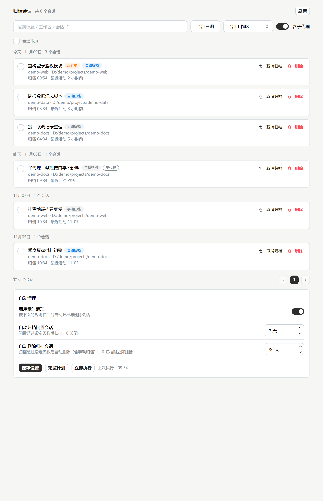
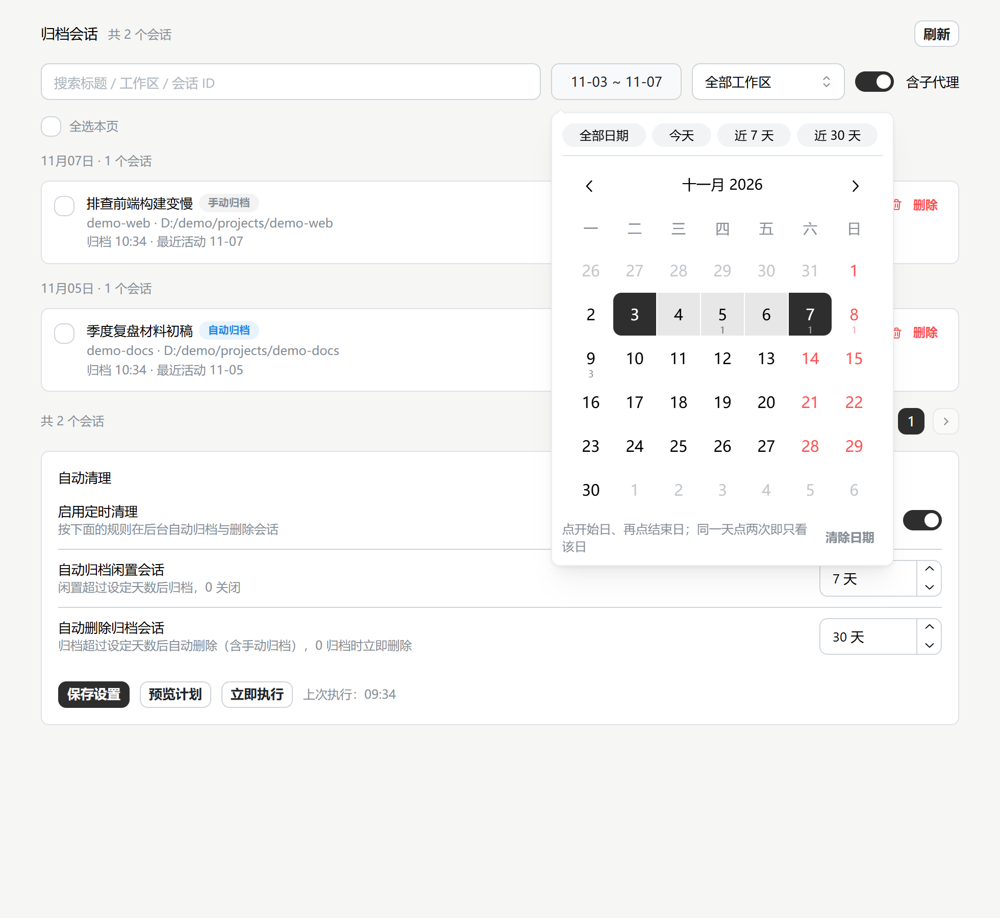

# Archive Manager for DSH · 归档会话管理

> 给 DeepSeek Harness 补上缺失的**归档管理中心**：侧栏「会话」只有"显示/隐藏已归档"一个开关，
> 归档之后既看不见、也找不回。装上本插件，**设置 → 归档会话**里就能按日期翻出历史会话、
> 一键批量取消归档，还有一套自动清理策略替你收拾越来越长的会话列表（自动归档闲置会话、
> 自动删除过期归档）。

[[English](#english)](#english)

[](https://dsh-plugin.org/plugins/gsnowdrift/dsh-archive-manager)

## 安装

```bash
dsh plugin --profile web add @gsnowdrift/dsh-archive-manager
```

桌面版把 profile 换成 `desktop`：

```bash
dsh plugin --profile desktop add @gsnowdrift/dsh-archive-manager
```

装完重启 DSH（或重新打开客户端），进入 **设置 → 归档会话**。

<details>
<summary>从源码安装 / 本地开发</summary>

```bash
git clone https://github.com/gsnowdrift/dsh-archive-manager.git
dsh plugin --profile desktop add "file:D:/path/to/dsh-archive-manager"
```

或在 Web 侧栏 **插件** 页 → 安装 → 输入本地绝对路径。
若 pnpm 拒绝 `file:`，可把 `link:` 依赖写进 profile 的 `package.json`，patch 见本仓库的 `cordis.patch.yml`。

改完代码后同步到 profile（`file:` 是**拷贝**不是软链，每次构建都要重装一次）：

```bash
npm run build:client      # 重新打包 lib/client.js
npm run install:desktop   # dsh plugin --profile desktop add "file:<本目录>"
```

然后重启 DSH。

</details>

## 能做什么

| 功能 | 说明 |
| --- | --- |
| 归档列表 | 标题、工作区、路径、归档时间、最近活动、来源（手动/自动）、运行状态 |
| 按日期筛选 | 范围日历（点开始日、再点结束日，日历上标每天会话数）+ 全部 / 今天 / 近 7 天 / 近 30 天快捷项 · 搜索标题/路径/会话 ID · 按工作区筛选 · 含子代理会话 |
| 分页 | 每页 25 条，页码与总数 |
| 批量操作 | 勾选后一键取消归档；单条"取消归档" |
| 删除会话 | 单条/批量删除**磁盘上的会话记录**，需二次确认、不可恢复（自动删除另见下方策略） |
| 自动清理 | 自动归档闲置会话 + 自动删除过期归档，支持"预览计划"和"立即执行" |
| 设置持久化 | 策略保存在插件自己的 storage domain（`archive_manager`），跨重启保留 |

### 截图





### 自动清理策略

| 策略 | 作用 | 默认 |
| --- | --- | --- |
| `cleanupEnabled` | 定时清理总开关（每 `cleanupIntervalMinutes` 分钟一次，默认 30） | 关 |
| `autoArchiveDays` | 闲置超过 N 天的会话**自动归档**（从侧栏隐藏） | 90 天，0 关闭 |
| `autoDeleteDays` | 归档超过 N 天的会话**自动删除**（含手动归档的，按各自的归档时刻起算）；**0 = 归档时立即删除** | 180 天 |

> **「自动删除」会物理删除会话日志，不可恢复。** 每个会话从自己进入归档的时刻起算，
> 超过 `autoDeleteDays` 天即删除；填 **0** 则归档动作发生的当下就删除（含手动归档的会话），
> 已归档的旧条目不受 0 影响，要清旧档请用列表里的批量删除。
> 运行中的会话一律跳过（`excluded`），不会打断正在跑的工作；
> 「预览计划」只算不执行，先给出将要归档/删除的**数量**与运行中跳过项，确认无误再「立即执行」。
> 不想自动删除：关闭「启用定时清理」，或把天数设得很大（上限 36500 天）。

## 使用

1. 打开 **设置**（侧栏齿轮），左栏点 **归档会话**；
2. 顶部「全部日期」按钮展开范围日历：点开始日、再点结束日即筛选该区间（同一天点两次＝只看那天），也可直接选 今天 / 近 7 天 / 近 30 天；日历上每个日期下方的数字是该日会话数。标题未折叠完成时先显示会话 ID，几秒后自动替换；
3. 勾选若干行 → **取消归档 N 项**，它们会回到原工作区原来的位置；
4. 下方"自动清理"卡片里调整策略 → **保存设置** → **预览计划** 先看清楚，再 **立即执行**。

## 结构

```text
package.json             # dsh.bundle.patch + dsh.client 声明
cordis.patch.yml         # bundle patch：插入 archive-manager 行
lib/index.js             # Host 半：ArchiveManagerService（Remote 命名空间 archiveManager）
src/client.jsx           # Client 半源码（React 18 + Mantine 7）
lib/client.js            # Client 半构建产物，勿手改（npm run build:client）
scripts/build-client.mjs # esbuild 打包：React/react-dom 走宿主 seed，Mantine 样式内联
locale/{zh,en}.json      # 面板元信息
```

### 开发

界面用 **Mantine 7**（MIT）实现，客户端半是**构建产物**：

```bash
npm install
npm run build:client                 # src/client.jsx → lib/client.js
npm run preview:ui                   # 可选：无头浏览器渲染 docs/ui-list.png / ui-datepicker.png
```

React 18.3.1 / react-dom / react/jsx-runtime 由 DSH Web 壳提供（平台 seed），不打进包里。
`preview:ui` 用 Playwright 驱动本机 Edge/Chrome（可用 `DSH_BROWSER_PATH` 指定）。

### Host Remote API（`remote.archiveManager`）

| 方法 | 参数 | 返回 |
| --- | --- | --- |
| `list` | `{ filter?: { date?, workspaceId?, search?, includeSubagents? }, page?, pageSize? }` | `{ total, page, pageCount, items[], workspaces, dates[], pending }` |
| `getSettings` | — | `{ policy, lastRun, intervalMinutes }` |
| `setPolicy` | policy 的部分字段 | 合并后的 policy |
| `unarchive` | sessionIds | `{ moved, failed[] }` |
| `deleteSessions` | sessionIds | `{ deleted, done[], failed[] }` |
| `preview` | — | 清理计划（不执行） |
| `runCleanup` | `{ dryRun? }` | 执行结果 `{ actions[], excluded[], applied, failed[] }` |

### 依赖

Host 半只使用 profile 已经提供的包：`@deepseek-ai/cordis`、`@deepseek-ai/schemastery`、
`@deepseek-ai/dsh-typert-protocol`、`@deepseek-ai/dsh-storage-domain`、`@deepseek-ai/dsh-session-query`、
`@deepseek-ai/dsh-workspace` 与 `zod`（都写在 `peerDependencies`，不额外安装）。

## 权限与数据

| 项 | 说明 |
| --- | --- |
| 读取什么 | profile 里已归档会话的元信息；折叠标题时读取这些会话自己的 JSONL 日志 |
| 写什么 | 归档集合（`workspaces` 的 `archivedSessionIds`）与插件自己的 storage 文件 `archive_manager.json` |
| 删除什么 | 手动删除需点击"删除"并二次确认；自动删除按 `autoDeleteDays` 策略执行（归档超 N 天删除，0 归档时立即删除），运行中的会话跳过，「预览计划」可先看名单 |
| 网络 | 不发任何网络请求，不采集遥测，不连接外部服务 |
| 凭据 | 不读写任何密钥 |

## 已知限制

- 归档集合本身不记录归档时间：本插件在看到某会话进入归档集合的那一刻记录时间；
  插件首次启动前就已归档的会话，用该会话 header 的创建时间兜底。
- 「自动删除」的倒计时从上面记录的归档时刻起算，因此插件首次启动前就已归档的会话，
  是从插件第一次看见它们算起，而不是真实归档时刻。
- 列表分组、日期筛选、日历上的每天数量，三者**统一按「归档时间」**（不是最近活动时间）；
  插件首次启动前就已归档的会话，其归档时间按插件第一次看到它们计算。
- 填 0 时「归档时立即删除」只对**插件启动后**新归档的会话生效：首次同步是一条基线，
  启动前就已在归档列表里的旧条目永远不会被 0 清掉（清旧档用列表里的批量删除）。
- 旧版本升级后策略里会多出「自动删除归档会话」，默认 180 天（沿用旧「保留期限」的默认值）；
  不想自动删除，请调大天数或关闭「启用定时清理」。
- 标题从会话日志里的 `session/title` 折叠而来，无法在请求里实时完成（冷启 85 个会话约 6 秒），
  因此首次打开列表时新会话可能短暂显示 ID，后台折叠完成后自动替换。
- 极少数只有控制事件的会话（例如被拆分进来的子会话）本身没有标题事件，显示为「（无标题）」加会话 ID。
- 归档集合可能残留会话日志已经不存在的条目（日志被别的工具删掉，或换了机器恢复备份）。这类条目折叠不出事实、也定位不到落盘文件，所以既只显示 ID 又删不掉；插件启动时与之后每分钟做一次孤儿清理，只把这类条目从归档集合和本地记录里摘掉，不碰任何会话文件，删除按钮对它们也只是清条目。
- 删除不是原子的「删文件 → 摘归档 → 删记录」：三个动作里任何一个没走成，就会留下上面那种空壳条目。所以插件先写墓碑、再摘归档；即使归档会员关系的写入失败，列表也不会再把该条目显示出来。
- 只注册了 `settings.section` 一处入口；宿主改这个 slot 名时该分区会静默不出现。
- 面向 DSH 0.2.x 的 Web/桌面客户端；Host 侧未在纯 CLI profile 上验证。

## English

**Archive Manager for DSH** adds the archived-session management surface that DeepSeek Harness lacks:
browse archived sessions by date / workspace / title, unarchive them in bulk, and run an
auto-cleanup policy that auto-archives idle sessions and auto-deletes archived ones after a
retention window (`autoDeleteDays`; 0 deletes at archiving). Auto-deletion is permanent and
touches session logs — the preview plan shows the list before anything runs.

```bash
dsh plugin --profile web add @gsnowdrift/dsh-archive-manager
```

Open **Settings → Archived sessions**. Requires DSH 0.2.x on the `desktop` or `web` profile. MIT licensed.

## License

[MIT](LICENSE)
